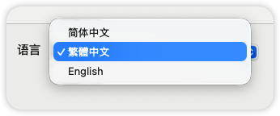
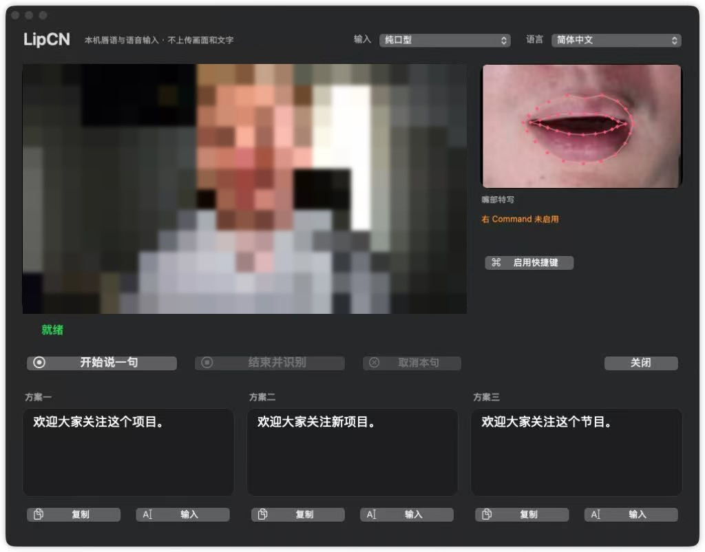

# LipCN · 不出声，也能打字 🫦

> 开会时不方便说话，图书馆里不能出声，深夜怕吵醒家人，嗓子哑了说不出来……
> 那就对着摄像头**默念**吧。LipCN 看你的嘴型，把你想说的话变成文字。

LipCN 是一个**跑在你自己 Mac 上的中文唇语输入法**。不联网、不上传画面，也不保存你说过的话。它还很年轻，经常认错字，但每天都在变准。这个仓库就是它的成长日记。

由 [BryceYuuu](https://github.com/BryceYuuu) 开发与维护。

---

## 📈 训练日记

### 前传：在网上找数据，教模型认中文（2026 年 10 月）

一开始手里什么数据都没有，只能去网上找公开的中文唇语模型和数据集，一轮一轮地试：

| 时间 | 做了什么 | 用的数据 | 字错误率 |
| --- | --- | --- | --- |
| 10 月 2 日 | 在 Lipflow 上加中文，先试 [CMLR](https://www.vipazoo.cn/CMLR.html) 中文唇语模型 | 央视新闻训练的现成模型 | 95.2%，几乎认不出 |
| 10 月 2 日 | 换成 [CNVSRC 2025](https://github.com/liu12366262626/CNVSRC2025) 公开唇语模型 | 现成模型 | 62.7% |
| 10 月 3 日 | 第 4 轮：下载智源 [Chinese-LiPS](https://huggingface.co/datasets/BAAI/Chinese-LiPS) 数据集，训练第一个 adapter | 1200 段视频、40 位说话者 | — |
| 10 月 4 日 | 第 5 轮：找 10 位模型没见过的人来验证 | 40 段新视频 | **56.3%**（完整人脸视频 65.5% → 55.6%） |
| 10 月 4 日 | 第 6 轮：试了 330 次不同的搜索参数 | 33 段开发视频 | 没找到更好的，保留原设置 |
| 10 月上旬 | 第 8 轮：继续用公开数据训练 | 240 段视频、40 位说话者 | 57.8% → 57.6%，几乎没变 |

公开数据练到第 8 轮就到瓶颈了：这些视频都是别人**出声说话**，而我要的是自己**默念**。所以接下来，我开始录自己的嘴型。

*95.2%、62.7%、56.3% 这三个数字，来自 10 月 4 日第 5 轮在同一批 40 段视频（10 位模型没见过的说话者）上的对比；第 8 轮的数字来自另一组 33 段开发视频。前传都是在公开数据集上测的，和下面用我自己默念的视频测的不是同一套测试，不能直接比较。*

### 正传：用我自己的嘴型

我每天花大约一个小时录自己的嘴型、训练模型。最后能练成什么样，我也不知道，但每天的数字都会如实记在这里。

| 日期 | 累计训练句 | 字错误率 | 完全念对 | 备注 |
| --- | --- | --- | --- | --- |
| 2026-11-03 | 0 | 59.9% | 0 / 39 | 起点：通用模型 + 中文语言模型 |
| 2026-11-03 | 20 | 52.0% | 2 / 39 | 第 1 天，训练 5 轮 |

*测试句固定为同一批 39 句，并且始终用和 app 相同的设置来测，所以每天的数字可以直接比较。不过最好的那一轮也是用这 39 句挑出来的，数字会略微偏乐观。*

## ✨ 它能做什么

- **默念就能打字**：只用摄像头，不打开麦克风。
- **先出草稿，再出精确结果**：念完后零点几秒就先显示一个草稿；完整识别跑完后，自动换成更准的结果。
- **最多三个候选**：认不准的时候给你几个不同的选项挑，可以直接改，改完一键复制或输入到其他 app。
- **简体、繁體都支持**：繁體会自动换成台湾常用说法，比如「软件 → 軟體」「视频 → 影片」。也支持英文唇语。
- **会出声的时候也能用**：切换到「语音优先」，就用本地的 Whisper 语音识别，听不清时再改用唇语。
- **快捷键**：按一下右 Command 开始，再按一下结束，Esc 取消。
- **为你量身训练**：录几十句自己的嘴型，一条命令就能训练出你的专属模型，而且只有比原来更准时才会启用。





*新界面：左边是摄像头预览，右边是嘴部特写，下面三张卡片是识别出的候选方案，可以直接修改、复制或输入。*

## 🚀 五分钟上手

需要 **Apple Silicon 的 Mac**（M1 及以后的芯片），系统 **macOS 14 或更新版本**。

```bash
git clone https://github.com/BryceYuuu/LipCN.git
cd LipCN
./install.sh                 # 安装依赖 + 下载语音识别模型
.venv/bin/lipcn              # 启动
```

想用中文唇语，还需要下载公开的唇语模型：

```bash
./install.sh --mode mandarin --accept-research-license
```

这些模型仅限研究和个人学习使用，不能商用，下载前请先看 [NOTICE](NOTICE)。

**关于 adapter**：中文唇语还需要一个「adapter」，可以理解为一个专门调教过的小插件。我自己用的那个不随仓库发布，所以你要用下面「一起训练」里的方法，**训练一个属于你自己的**。这反而是好事：专属的通常比通用的更准。

其他命令：

- `lipcn doctor`：检查环境和模型是否齐全，不联网，也不打开摄像头。
- 详细安装说明见 [桌面安装与模型准备](desktop/mandarin/README.md)。

## 🏋️ 一起训练

一个人的嘴型能教会模型的东西有限，人越多，我们越能搞清楚什么方法真的有用。欢迎用下面任何一种方式参与：

### 1. 训练你自己的嘴型（最推荐）

整个过程都在你自己的电脑上完成，视频和模型都不会离开你的电脑。

```bash
# ① 录 40 句测试句（约 15 分钟）
.venv/bin/lipcn collect --speaker me --session dev-$(date +%Y%m%d) --split dev \
  --lighting indoor-front --prompts research/examples/webcam-baseline-prompts.json

# ② 换一天，录训练句（可以分几次录，已经录过的句子会自动跳过）
.venv/bin/lipcn collect --speaker me --session train-$(date +%Y%m%d) --split train \
  --output "$HOME/Library/Application Support/LipCN/personal-data" --max-megabytes 2048 \
  --lighting indoor-front --prompts research/examples/personal-train-prompts.json

# ③ 一条命令训练（最多 30 分钟），比原来更准才会启用
research/scripts/train_personal_adapter.sh
```

录制窗口会用大字显示要念的句子：按空格开始，念完再按空格结束，按 Enter 保存。平时用的时候会出声的话，录制命令后面加上 `--voiced`。

完整步骤见 [个人口型适配](docs/validation/personal-adaptation.md)。

### 2. 分享你的成绩

训练脚本跑完会输出一段「训练成绩」，复制下来，[开一个「训练成绩分享」Issue](https://github.com/BryceYuuu/LipCN/issues/new?template=training-report.md) 贴上就行。

**只贴数字，不要上传视频或带脸的截图。** 不同口音、不同摄像头、不同光线下的数据，能帮我们找出哪些因素影响最大。

### 3. 贡献句子

训练句越贴近日常，模型越懂人话。欢迎提交 PR，往 [`research/examples/`](research/examples/) 里加句子：

- 各地口语，比如台湾、香港、东北、四川的说法；
- 工作、聊天、点餐等常用场景；
- 带人名、数字的句子。

用简体书写，避免生僻字。格式参考现有的 `personal-train-prompts.json`。

### 4. 贡献录像？先聊聊

录像里有你的脸，属于很敏感的个人信息，**请不要上传到公开的 Issue 或 PR**。如果你愿意把录像贡献给大家一起训练，请先开 Issue 聊聊，我们会单独约定用途、保存方式和删除方式。

## 🔒 隐私

- 识别全程在本机完成，不上传录音、画面或文字。
- 不保存你说过的句子，也不读取你正在编辑的文字内容。
- 只有你主动运行录制工具时，才会把录像保存到本机，用来训练。
- 默认的唇语模式完全不打开麦克风。

## 🧪 技术细节

- 唇语识别基于 [CNVSRC 2025](https://github.com/liu12366262626/CNVSRC2025) 的中文唇语模型，加上一个 adapter，并在搜索过程中融合 CMLR 中文语言模型。在 40 段公开验证视频上，语言模型让字错误率从 57.2% 降到 55.8%，详见 [语言模型融合实验](docs/validation/lm-fusion.md)。
- 草稿用的是 CTC 贪心解码，几乎不耗时（约 3 毫秒），字错误率只比完整搜索高约 3 个百分点。
- 全仓库共 1541 项自动测试通过（另有 24 项跳过）。
- 研究工具、实验记录和评测方法见 [`research/`](research/README.md)。

| 目录 | 内容 |
| --- | --- |
| [`desktop/mandarin/`](desktop/mandarin/) | 中文桌面 app |
| [`research/`](research/README.md) | 训练、评测、录制工具和实验记录 |
| [`docs/validation/`](docs/validation/) | 各项改进的验证数据 |
| [`lipflow/`](lipflow/) | 原项目的共享组件，以及保留的旧版入口 |

## 📄 许可

代码采用 [MIT 许可](LICENSE)，并保留原作者的版权声明。模型和数据集有各自的许可，详见 [NOTICE](NOTICE)：CNVSRC、CMLR 等唇语模型仅限研究和个人学习，不能因为代码是 MIT 就拿去商用。本仓库不分发这些模型、adapter 和数据集。

## ☕ 赞助支持

如果这个项目让你觉得有趣，或者帮到了你，欢迎请我喝杯咖啡，支持我持续训练和更新：

- [GitHub Sponsors](https://github.com/sponsors/BryceYuuu)：信用卡 / PayPal
- [爱发电](https://afdian.com/a/bryce)：微信 / 支付宝

## 🙏 致谢

感谢 [Amy Zhou](https://github.com/amywork777) 创建并开源了 [Lipflow](https://github.com/amywork777/lipflow)，LipCN 就是从它出发的。也感谢 CNVSRC、CMLR、Chinese-LiPS 背后的研究者，以及所有开源贡献者。

---

LipCN 专注于中文输入，并集成原项目的英文口型识别。体验完整的原版英文应用，欢迎使用原作者 [Amy Zhou（@amywork777）](https://github.com/amywork777) 的 [Lipflow 项目](https://github.com/amywork777/lipflow)。

LipCN focuses on Mandarin input and also integrates the original English lip-reading model. For the full original English application, check out [Lipflow](https://github.com/amywork777/lipflow) by [Amy Zhou (@amywork777)](https://github.com/amywork777).
