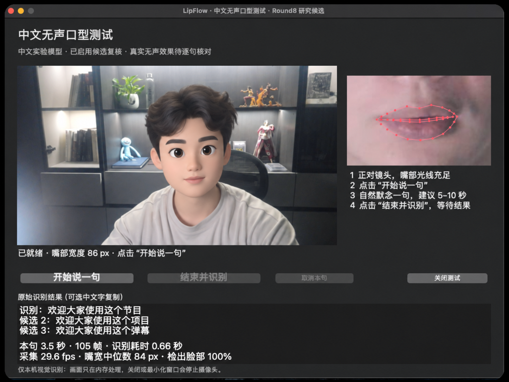

# LipCN · 本地语音与唇语输入

**支持简体中文、繁體中文和 English，默认简体中文。** 在本机把中文语音或中英文口型转换成文字，再从三个表达方案中选择。由 [BryceYuuu](https://github.com/BryceYuuu) 开发与维护。

**Supports Simplified Chinese, Traditional Chinese and English, with Simplified Chinese selected by default.** Turn Mandarin speech or Mandarin/English lip movements into text on your Mac, then choose from three wording options. Developed and maintained by [BryceYuuu](https://github.com/BryceYuuu).

LipCN 专注于中文输入，并集成原项目的英文口型识别。体验完整的原版英文应用，欢迎使用原作者 [Amy Zhou（@amywork777）](https://github.com/amywork777) 的 [Lipflow 项目](https://github.com/amywork777/lipflow)。

LipCN focuses on Mandarin input and also integrates the original English lip-reading model. For the full original English application, check out [Lipflow](https://github.com/amywork777/lipflow) by [Amy Zhou (@amywork777)](https://github.com/amywork777).

## 功能 / Features

| 中文 | English |
| --- | --- |
| **三种语言**：默认简体中文；繁體中文共用中文识别模型，结果、复制与输入均输出繁体；English 使用原项目的英文口型模型，仅采集画面。 | **Three language choices:** Simplified Chinese by default; Traditional Chinese uses the same Mandarin recognizer with traditional output for display, copy and insertion; English uses the original visual model with camera-only capture. |
| **两种输入方式**：语音优先使用本地 Whisper 并按需回退口型；纯口型模式只用摄像头，不申请或打开麦克风。 | **Two input modes:** speech-first uses local Whisper with visual fallback on demand; lip-only uses the camera without requesting or opening the microphone. |
| **先出结果、直接修改**：方案一先显示并开放复制/输入，再补充方案二、三；三个文本框可编辑，后续生成保留你的修改。 | **Early, editable results:** Option 1 is usable before Options 2 and 3 finish. Edit any available option before copying or inserting; later generation preserves your edits. |
| **快速文字整理**：默认用保守规则补标点、整理有限口语词和填充词，检查数字、时间、否定等改动；无需等待大模型润色，允许方案重复。 | **Fast wording cleanup:** conservative rules handle punctuation, limited register changes and fillers, while checking numbers, time references and negation. No wording-model wait by default; options may repeat. |
| **右 Command 切换**：按一下开始、再按一下结束；Esc 取消，也可使用窗口按钮。 | **Right Command toggle:** press once to start and again to finish; Esc cancels, with on-screen buttons available too. |
| **识别期间实时预览**：结束本句后画面继续流动，并显示处理进度；识别完成、取消或隐藏窗口即关闭摄像头。录制最长 20 秒。 | **Live preview during recognition:** ending an utterance keeps the preview moving with a progress indicator. Completion, cancellation or hiding closes the camera. Recording is capped at 20 seconds. |
| **本机处理**：中文桌面入口不上传录音、画面或识别文字，不保存句子历史，也不读取焦点输入框内容。 | **On-device processing:** the Mandarin desktop entry does not upload audio, frames or recognized text, store sentence history, or read text from the focused field. |
| **按需加载与失败恢复**：先准备当前输入方式需要的识别器；其余模型按需加载。语言切换先检查文件，失败时恢复原选择，并可重试。 | **On-demand loading and recovery:** prepare the selected recognizer first; load other models only when needed. Language switches check assets before replacing a model and restore the previous selection on failure, with retry available. |

上述功能对应当前 **LipCN 2.3.0**（`desktop/mandarin/`），面向 **Apple Silicon Mac、macOS 14+、Python 3.11–3.12**。中文口型识别仍处于实验阶段，真实无声表达需要逐句核对。

These features describe **LipCN 2.3.0** (`desktop/mandarin/`) for **Apple Silicon Macs, macOS 14+, and Python 3.11–3.12**. Mandarin lip reading remains experimental; review each result, especially for silently mouthed speech.

## 界面 / Preview


*三种语言可选，默认简体中文；简繁共用中文识别，English 使用英文口型模型。*

*Three language choices, with Simplified Chinese as the default. Both Chinese writing systems share the Mandarin recognizer; English uses the English visual model.*



*上图为早期中文纯口型测试界面；当前版本已加入语音优先，并将结果区精简为三个方案。截图中的单句耗时不代表通用性能。*

*The image shows an earlier Mandarin lip-only prototype. The current version adds speech-first recognition and a simpler three-option result area. The timing shown in the screenshot is not a general performance benchmark.*

## 开始使用 / Getting started

```bash
git clone https://github.com/BryceYuuu/LipCN.git
cd LipCN
```

安装依赖后，统一使用 `lipcn` 启动当前桌面窗口。`doctor` 检查环境和模型；`setup` 只有带 `--download` 才联网下载，并校验固定版本与 SHA-256。详细说明见 **[桌面安装与模型准备](desktop/mandarin/README.md)**。

Use `lipcn` to launch the current desktop. `doctor` checks the environment and assets; `setup` downloads only with `--download`, using pinned revisions and SHA-256 verification. See **[desktop setup](desktop/mandarin/README.md)**.

```bash
python3.12 -m venv .venv
.venv/bin/python -m pip install -e '.[desktop]'
.venv/bin/lipcn doctor --mode speech
.venv/bin/lipcn setup --mode speech --download
.venv/bin/lipcn
```

1. 选择语言与输入方式；每次启动默认简体中文，输入方式会记住上次选择。 / Choose a language and input mode. Each launch starts in Simplified Chinese; the input-mode preference is remembered.
2. 点击“开始说一句”，说话或自然默念，再点击“结束并识别”。 / Click Start, speak or silently mouth a sentence, then finish.
3. 方案一出现即可修改、复制或输入；后续两个方案准备好后自动显示。 / Edit, copy or insert Option 1 as soon as it appears; the other options follow.

只有主动开始才采集；点击结束后停止本句录音和识别帧收集，仅继续实时预览，直到结果完成。取消、隐藏、最小化或关闭立即请求停止摄像头，后续预览帧不送入识别、不保存。纯口型及 English 不打开麦克风。输入原应用需要辅助功能权限。简繁切换共用中文模型；English 识别英文口型，不做翻译。

Capture starts only on request. Finish stops utterance audio and recognition-frame collection while live preview continues until results are complete. Cancel, hide, minimize and close immediately request camera shutdown. Later preview frames are neither recognized nor saved. Lip-only and English never open the microphone. Insertion requires Accessibility permission. Both Chinese scripts share the Mandarin model; English reads English lips without translation.

中文纯口型需要另行准备兼容的研究 adapter；仓库与通用安装包不分发私人权重。缺少该组件时仍可使用已准备好的中文语音输入和英文口型。安装不会把研究模型变成不受限制的商用模型。

Mandarin visual recognition requires a compatible research adapter, distributed separately. Private weights are absent from the repository and general-purpose package. Prepared Mandarin speech and English visual modes remain usable without it. Model licenses continue to apply.

## 项目结构 / Project layout

| 路径 / Path | 说明 / Description |
| --- | --- |
| [`desktop/mandarin/`](desktop/mandarin/) | 当前中文语音与唇语桌面入口 / Current Mandarin speech-and-lip desktop entry |
| [`lipflow/`](lipflow/) | 共享组件与保留的原有运行入口 / Shared components and retained legacy runtime |
| [`research/`](research/README.md) | 独立的中文训练、评测与研究报告 / Mandarin training, evaluation and research reports |
| [`tests/`](tests/), [`desktop/mandarin/tests/`](desktop/mandarin/tests/) | 核心及中文桌面回归测试 / Core and Mandarin desktop regression tests |
| [旧版英文说明](README.legacy.md) · [旧版中文说明](README.legacy.zh-CN.md) | 原有跨平台入口与设置，其行为和隐私选项与当前中文窗口不同 / Legacy cross-platform entry points with their own behavior and privacy settings |

## 性能与验证 / Performance and validation

当前源码默认快速整理三个方案，不加载 MLX 表达模型；识别模型和解码参数保持不变。纯规则短句实测首调用约 **0.2–25 毫秒**（含首次简繁转换初始化），只代表文字整理。需要原有模型润色时，以 `LIPCN_WORDING_MODE=model lipcn` 启动。中文纯口型建议选择“纯口型”，提前准备视觉模型；语音优先首次回退口型仍需要加载模型。详见[预览与等待时间修复记录](docs/validation/live-preview-fix.md)。

The current source defaults to fast rule-based options without loading MLX. Recognition weights and decoding settings are unchanged. First-call formatting of short synthetic phrases took roughly **0.2–25 ms**, including script-conversion initialization; this excludes recognition. Opt into the previous model-backed cleanup with `LIPCN_WORDING_MODE=model lipcn`. Select Lip only for silent use so the visual recognizer is prepared before recording; the first visual fallback in Speech first still has a loading cost.

此前 2.3.0 发布包将“识别完成后的第一条可用结果”和“后续文字整理”分开：第一条不加载表达模型。真实本机文字整理测试中，四条合成测试句的第一条准备耗时为 **0.02–15.14 毫秒**；全部三个方案为 **0.57–9.40 秒**（首条含表达模型冷加载）。这些数字只衡量文字整理，不含录制、语音/口型识别，不能作为整句端到端速度承诺。

Version 2.3.0 separates the first usable recognition from subsequent wording work. The first option does not load the wording model. On this development Mac, four synthetic-text checks took **0.02–15.14 ms** to prepare Option 1 and **0.57–9.40 s** for all three options, including a cold model load in the first case. These are formatting-only measurements, excluding capture and recognition.

当前没有经确认的真实无声独立样本，因此本版**不宣称无声中文准确率提高，也没有替换默认权重**。新增独立采集、数据隔离审计，以及替换/删除/插入错误、人名和数字错误报告，见 [真实无声采集与验收](research/SILENT_EVALUATION.md)。采集工具会明确保存你主动录制的本地视频；普通桌面输入仍不保存视频或句子历史。

There are no verified independent silent-speech samples yet, so this version **makes no silent-Mandarin accuracy claim and does not replace the default weights**. New tools support explicit local collection, split-leakage audits and substitution/deletion/insertion, name and number error reports. See [silent collection and evaluation](research/SILENT_EVALUATION.md). The collection tool explicitly saves recordings; ordinary desktop input still stores neither videos nor sentence history.

当前全仓回归 **1,310 项通过、24 项跳过**。自动回归覆盖先显示后补全、编辑保留、取消隔离、纯口型禁用语音、启动和语言失败恢复；实际设备与无声准确率需单独验证。

The full repository suite passes **1,310 tests, with 24 skipped**. Automated regressions cover early results, edit preservation, cancellation isolation, speech exclusion in lip-only mode, startup and language-switch recovery. Real-device behavior and silent accuracy require separate validation.

## 许可 / License

项目代码保留 [MIT License](LICENSE) 与原作者版权声明。第三方组件、模型和数据适用各自许可，详见 [NOTICE](NOTICE)。CNVSRC/CMLR 等研究权重的使用限制不会因为本仓库代码采用 MIT 而改变；此仓库不重新分发这些权重、适配参数或数据集。

The project code retains its [MIT License](LICENSE) and original copyright notice. Third-party components, models and datasets retain their own terms; see [NOTICE](NOTICE). The MIT code license does not remove the restrictions on research weights such as CNVSRC/CMLR. Those weights, adapters and datasets are not redistributed here.

## 致谢 / Acknowledgements

感谢 **[Amy Zhou](https://github.com/amywork777)** 创建并开源 **[Lipflow](https://github.com/amywork777/lipflow)**，让这个项目有了起点。也感谢原项目所依赖的研究者与开源贡献者。本仓库在原作基础上独立维护，继续探索中文语音与唇语输入。

Thank you to **[Amy Zhou](https://github.com/amywork777)** for creating and open-sourcing **[Lipflow](https://github.com/amywork777/lipflow)**, the foundation of this project. Thanks also to the researchers and open-source contributors behind its components. This repository is maintained independently and continues exploring Mandarin speech and lip-based input.
